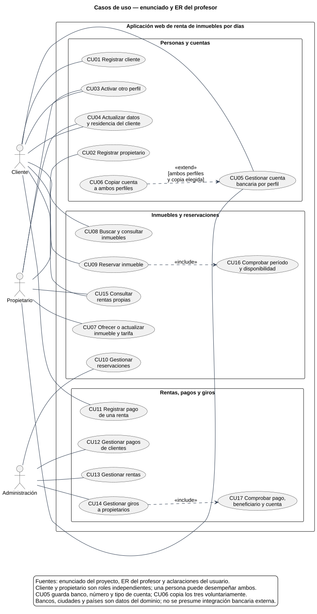

# Casos de uso — enunciado y modelo del profesor

[Fuente editable](casos_uso_profesor.puml) · [Clases relacionadas](DIAGRAMA_CLASES.md).

## Base documental y alcance

Se contrastó **Proyecto - Airbnb.pdf**, página 1, tanto su texto como el ER incrustado, con **3 - Diagrama de clases.pdf** y **4 - Casos de Uso.pdf**. Se incorporan las aclaraciones del usuario sobre entidades separadas, activación de ambos perfiles, cuentas independientes editables y copia explícita de banco, número y tipo a ambos perfiles.

El enunciado pide una aplicación web Java/PostgreSQL para ofrecer y buscar inmuebles por días, clientes registrados y administración de rentas, reservaciones, pagos y giros. Estos últimos **sí pertenecen al alcance académico**, aunque no sean entidades dibujadas en el ER. El documento anterior los excluía indebidamente; esta versión corrige esa omisión.

Los casos describen objetivos y resultados del análisis, no pantallas, endpoints ni código de DayNest. No incorporan su comisión del 30 %, sus giros automáticos, su vencimiento de 30 minutos, sus nueve tablas auxiliares ni sus mecanismos técnicos. Los flujos propuestos que concretan requisitos generales se identifican como decisiones de análisis.

## Actores y notación

| Actor externo | Responsabilidad |
|---|---|
| Cliente | Registrarse, mantener sus datos y cuenta, buscar, reservar y registrar el pago de una renta. |
| Propietario | Registrarse, mantener sus datos y cuenta, ofrecer inmuebles con su tarifa y consultar sus rentas. |
| Administración | Gestionar reservaciones, rentas, pagos de clientes y giros a propietarios, como exige el texto. |

Cliente y Propietario son roles independientes: una persona puede ejercer ambos. En CU01/CU02, el actor representa a la persona que solicita adquirir ese rol. Banco, Ciudad y Pais son información del dominio, sin interacción externa demostrada; no se dibujan como actores. El sistema no es un actor de sí mismo. No se inventa una jerarquía de usuarios o un actor bancario.

Se aplica la guía de casos de uso, páginas 9–13, 16–20 y 26–27: nombres con verbos, límite del sistema, asociaciones y flujos actor–sistema. `include` apunta del caso base al comportamiento obligatorio; `extend` apunta de la extensión opcional al caso base.

- CU09 incluye CU16: toda reserva comprueba período y disponibilidad.
- CU14 incluye CU17: todo giro comprueba el pago, beneficiario y cuenta.
- CU06 extiende CU05 solo si existen ambos perfiles y la persona solicita copiar la cuenta. Tener ambos perfiles no dispara la copia por sí solo.
- Buscar no se incluye obligatoriamente en Reservar: el inmueble podría haberse seleccionado previamente. Tampoco se incluye un inicio de sesión en cada operación; el reconocimiento de identidad y permisos se expresa como precondición, sin diseñar autenticación.

## Reglas comunes y decisiones de análisis

Los casos de datos y cuentas solo permiten actuar sobre la propia información; los administrativos requieren el papel Administración. Se propone validar campos obligatorios, referencias existentes y montos positivos. Una operación fallida o abandonada antes de confirmar no modifica datos. La interfaz informa del resultado o del dato que debe corregirse.

El enunciado no define políticas de cancelación, devoluciones, plazos, comisión, fecha de giro, límites geográficos de búsqueda o estados exactos. No se fijan aquí. Se propone representar la reservación y evolución de la renta en una misma ocurrencia Renta, permitir consultar las rentas propias, verificar disponibilidad y representar intentos de pagos/giros mediante estado. Son decisiones coherentes con la gestión solicitada, no citas del enunciado.

Cada ficha es **esencial**, centrada en el comportamiento. Los casos auxiliares incluidos son de sistema, invocados por su caso base. La información de salida se describe sin imponer una pantalla concreta.

## CU01 — Registrar cliente

**Actor iniciador:** Cliente. **Tipo:** primario, usuario. **Responsabilidad/propósito:** incorporar al cliente registrado exigido por el enunciado. **Referencias:** Cliente, Reside; CU02–CU05.

**Precondición:** la persona solicita registrarse y no tiene ese perfil. **Poscondición:** existe el cliente con sus datos y ciudad de residencia. Si elige ambos perfiles, también queda registrado como propietario, sin duplicar un perfil existente. **Salida:** resumen de perfiles y datos registrados.

| Actor | Sistema |
|---|---|
| 1. Solicita perfil cliente, o ambos, e indica nombre, teléfono, correo y ciudad. | Valida datos y referencias; identifica perfiles ya existentes. |
| 2. Confirma. | Registra los perfiles elegidos y muestra el resultado. |

**Alternativas:** datos inválidos requieren corrección; un perfil existente se conserva y se ofrece actualizarlo o activar el otro. Un fallo al registrar ambos no deja una confirmación parcial inadvertida. La captura bancaria se realiza mediante CU05.

## CU02 — Registrar propietario

**Actor iniciador:** Propietario. **Tipo:** primario, usuario. **Propósito:** incorporar a la persona que ofrecerá inmuebles. **Referencias:** Propietario; CU01, CU03, CU05, CU07.

**Precondición:** no existe ese perfil para la persona. **Poscondición:** propietario registrado; si se eligen ambos, también cliente con su residencia. **Salida:** perfiles y datos registrados.

| Actor | Sistema |
|---|---|
| 1. Indica nombre, teléfono, correo y los perfiles elegidos. | Valida y, para ambos, solicita los datos adicionales del cliente. |
| 2. Confirma. | Registra lo solicitado y presenta confirmación. |

**Alternativas:** datos incompletos se corrigen; un perfil existente no se duplica. Un abandono no guarda la solicitud. CU05 permite completar la cuenta.

## CU03 — Activar otro perfil

**Actor iniciador:** Cliente o Propietario. **Tipo:** secundario, usuario. **Propósito:** permitir adquirir el otro rol, conservando el actual. **Referencias:** aclaración del usuario; CU01–CU02, CU05.

**Precondición:** persona registrada y reconocida con un solo perfil. **Poscondición:** dispone de ambos, con sus relaciones independientes. **Salida:** perfiles activos y datos pendientes de completar.

| Actor | Sistema |
|---|---|
| 1. Solicita el otro perfil y completa sus datos requeridos. | Comprueba que no exista y valida la información; solicita ciudad al activar Cliente. |
| 2. Confirma. | Crea el perfil faltante, preserva el existente y permite usar ambos roles. |

**Alternativas:** si ya tiene ambos no se crea nada; datos inválidos o abandono conservan el perfil original. Activar no copia automáticamente cuentas bancarias.

## CU04 — Actualizar datos y residencia del cliente

**Actor iniciador:** Cliente o Propietario, sobre su propio perfil. **Tipo:** secundario, usuario. **Propósito:** mantener nombre, teléfono y correo; para Cliente, también ciudad. **Referencias:** entidades Cliente, Propietario y Ciudad.

**Precondición:** existe el perfil seleccionado y la persona está reconocida. **Poscondición:** datos válidos actualizados, sin modificar cuentas bancarias. **Salida:** datos guardados.

| Actor | Sistema |
|---|---|
| 1. Selecciona su perfil y modifica datos. | Presenta valores actuales y valida los cambios, incluida la ciudad del cliente. |
| 2. Confirma. | Guarda y muestra la información resultante. |

**Alternativas:** referencias inválidas o datos obligatorios ausentes se corrigen; un perfil ajeno se rechaza. La sincronización automática de datos entre perfiles no se exige en esta entrega.

## CU05 — Gestionar cuenta bancaria por perfil

**Actor iniciador:** Cliente o Propietario. **Tipo:** secundario, usuario. **Propósito:** registrar o cambiar banco, número y tipo de cuenta del perfil elegido. **Referencias:** Vincula, Relaciona, Banco; CU06.

**Precondición:** perfil propio existente; catálogo de bancos disponible. **Poscondición:** los tres datos quedan guardados en su relación bancaria. La otra cuenta se conserva, salvo extensión CU06 elegida. **Salida:** perfil, banco y cuenta resultantes.

| Actor | Sistema |
|---|---|
| 1. Elige su perfil e indica banco, número y tipo. | Muestra datos actuales y valida banco existente y campos completos. |
| 2. Confirma; opcionalmente solicita copiar a ambos perfiles. | Guarda en Vincula o Relaciona; si se cumple la condición, ejecuta CU06. |

**Alternativas:** banco inexistente, datos incompletos o perfil ajeno se rechazan sin cambios. Cancelar conserva los datos previos. No se presume comprobación de la cuenta con un banco real.

## CU06 — Copiar cuenta a ambos perfiles

**Actor iniciador:** Cliente o Propietario, desde CU05. **Tipo:** opcional, usuario; extensión. **Propósito:** usar voluntariamente los mismos tres datos en ambos roles. **Referencias:** aclaración del usuario; CU05.

**Precondición:** ambos perfiles pertenecen a la persona y la opción de copia está seleccionada. **Poscondición:** Vincula y Relaciona guardan el mismo banco, número y tipo; siguen siendo relaciones independientes. **Salida:** confirmación para ambos perfiles.

| Actor | Sistema |
|---|---|
| 1. Solicita copiar la cuenta que está guardando. | Comprueba ambos perfiles y valida los tres datos. |
| 2. Confirma. | Guarda ambas cuentas conjuntamente y confirma. |

**Alternativas:** sin ambos perfiles se rechaza la copia; si falla un guardado, ninguno cambia. No seleccionar la opción deja intacta la otra cuenta. Las ediciones posteriores son independientes.

## CU07 — Ofrecer o actualizar inmueble y tarifa

**Actor iniciador:** Propietario. **Tipo:** primario, usuario. **Propósito:** poner bienes a disposición para renta por días. **Referencias:** Inmueble, Asocia, Ciudad; requisito expreso del enunciado.

**Precondición:** propietario registrado; para editar, inmueble propio; ciudad existente. **Poscondición:** inmueble asociado al propietario, con ubicación, características y precio por noche. **Salida:** ficha y tarifa guardadas.

| Actor | Sistema |
|---|---|
| 1. Introduce o modifica dirección, área, habitaciones, capacidad, ciudad y precio. | Comprueba datos, referencias y pertenencia; propone exigir capacidad y tarifa positivas. |
| 2. Confirma su oferta. | Guarda Inmueble y Asocia y permite encontrar el bien en la consulta. |

**Alternativas:** datos inválidos se corrigen; editar un inmueble ajeno se rechaza. No se añaden fotos, tipos de alojamiento, bloqueos o estados de publicación del sistema implementado.

## CU08 — Buscar y consultar inmuebles

**Actor iniciador:** Cliente. **Tipo:** primario, usuario. **Propósito:** facilitar la búsqueda para tomar un inmueble en arriendo. **Referencias:** Inmueble, Ciudad, Pais y Asocia; requisito expreso.

**Precondición:** consulta de un cliente registrado. **Poscondición:** se muestran coincidencias sin registrar una renta. **Salida:** características, ubicación y tarifa; detalles del inmueble seleccionado.

| Actor | Sistema |
|---|---|
| 1. Indica criterios de ubicación y, opcionalmente, capacidad o período. | Valida criterios y consulta bienes ofrecidos; si hay período, considera disponibilidad. |
| 2. Selecciona un resultado. | Presenta características y precio para decidir si solicita CU09. |

**Alternativas:** sin coincidencias se informa y permite cambiar criterios; período inválido requiere corrección. Los filtros concretos son propuesta de análisis; el enunciado exige facilidad de búsqueda sin enumerarlos.

## CU09 — Reservar inmueble

**Actor iniciador:** Cliente. **Tipo:** primario, usuario. **Propósito:** solicitar renta de un inmueble por un período. **Referencias:** Renta; CU08, CU16 y gestión de reservaciones del enunciado.

**Precondición:** cliente registrado, inmueble ofrecido y propietario asociado. **Poscondición:** reservación registrada como ocurrencia de Renta. **Salida:** cliente, inmueble, fechas, tarifa y estado de la solicitud.

| Actor | Sistema |
|---|---|
| 1. Selecciona inmueble e indica entrada y salida. | Ejecuta CU16 y presenta el resumen y las condiciones conocidas. |
| 2. Confirma. | Recomprueba disponibilidad al guardar y registra la solicitud. |

**Alternativas:** fechas inválidas, inmueble inexistente o cruce con otra reserva impiden confirmar. Si cambió disponibilidad durante la operación, informa y permite otro período. La recomprobación es una decisión de integridad, sin imponer un mecanismo PostgreSQL particular.

## CU10 — Gestionar reservaciones

**Actor iniciador:** Administración. **Tipo:** primario, usuario. **Propósito:** consultar y resolver las solicitudes de reserva. **Referencias:** requisito expreso; Renta y CU09.

**Precondición:** actor administrativo reconocido y solicitudes existentes para gestionar. **Poscondición:** solicitud revisada y decisión administrativa registrada. **Salida:** lista, detalle y estado resultante.

| Actor | Sistema |
|---|---|
| 1. Selecciona una reservación y la decisión que desea registrar. | Muestra cliente, inmueble, período y situación; comprueba que la decisión sea válida. |
| 2. Confirma. | Guarda el resultado e informa a la administración. |

**Alternativas:** reserva inexistente, decisión incompatible o información cambiada se rechazan. Aceptar/rechazar es una concreción propuesta de «gestionar»; el enunciado no fija políticas de cancelación o vencimiento.

## CU11 — Registrar pago de una renta

**Actor iniciador:** Cliente. **Tipo:** primario, usuario. **Propósito:** aportar y registrar información de un pago asociado a su renta. **Referencias:** Pago, Renta; gestión de pagos exigida en el texto; CU12.

**Precondición:** renta propia y obligación de pago identificada. **Poscondición:** pago registrado para revisión, sin afirmar que se recibió dinero real. **Salida:** renta, monto, fecha y estado del registro.

| Actor | Sistema |
|---|---|
| 1. Selecciona su renta e indica los datos del pago. | Muestra la situación y comprueba renta, importe y consistencia. |
| 2. Confirma. | Registra la información vinculada a la renta para su gestión administrativa. |

**Alternativas:** renta ajena o inexistente e importe inválido se rechazan; un registro repetido se revisa para evitar duplicar el mismo hecho. El mecanismo de pago y la confirmación del dinero no están definidos en el enunciado. Este canal de registro por el cliente es una propuesta; la administración gestiona el resultado mediante CU12.

## CU12 — Gestionar pagos de clientes

**Actor iniciador:** Administración. **Tipo:** primario, usuario. **Propósito:** consultar y registrar el resultado de los pagos. **Referencias:** requisito expreso; Pago, Renta y CU11.

**Precondición:** actor administrativo reconocido; renta identificada y datos de pago disponibles. **Poscondición:** pago y resultado actualizados coherentemente con la renta. **Salida:** pagos de la renta y situación de cobro.

| Actor | Sistema |
|---|---|
| 1. Consulta una renta y los pagos o información de cobro que debe gestionar. | Presenta registros y permite registrar o revisar el pago y su resultado. |
| 2. Confirma los datos comprobados. | Valida importes y conserva el resultado de gestión sin duplicar el pago. |

**Alternativas:** información insuficiente mantiene el caso sin confirmar; inconsistencias o repetición requieren revisión. No se define pasarela ni un flujo de devoluciones que el texto no pide.

## CU13 — Gestionar rentas

**Actor iniciador:** Administración. **Tipo:** primario, usuario. **Propósito:** seguir la renta más allá de la solicitud de reserva. **Referencias:** requisito expreso; Renta, CU10, CU12 y CU14.

**Precondición:** renta existente y actor administrativo reconocido. **Poscondición:** situación de la renta revisada y actualización válida registrada. **Salida:** cliente, propietario, inmueble, fechas y situación de pagos/giros.

| Actor | Sistema |
|---|---|
| 1. Selecciona la renta y solicita consultar o actualizar su situación. | Presenta información y verifica la coherencia del cambio propuesto. |
| 2. Confirma la gestión. | Registra la situación resultante y muestra el resumen. |

**Alternativas:** renta inexistente o cambio incompatible se rechaza. Se propone distinguir solicitud, renta en curso y finalizada sin atribuir al profesor nombres de estados, transiciones o automatismos específicos.

## CU14 — Gestionar giros a propietarios

**Actor iniciador:** Administración. **Tipo:** primario, usuario. **Propósito:** gestionar y registrar la entrega de valores al propietario por una renta. **Referencias:** requisito expreso; Giro, Renta, Propietario, Relaciona; CU17.

**Precondición:** actor administrativo reconocido y renta con pagos registrados para liquidar. **Poscondición:** resultado del giro registrado con renta y beneficiario correctos; solo se marca realizado si existe confirmación válida. **Salida:** propietario, cuenta, renta, importe y estado.

| Actor | Sistema |
|---|---|
| 1. Selecciona renta e importe del giro. | Ejecuta CU17 y presenta beneficiario y cuenta para revisión. |
| 2. Confirma el resultado de la gestión del giro. | Comprueba que no duplique un hecho registrado y conserva su resultado. |

**Alternativas:** falta de pago, cuenta incompleta, beneficiario incorrecto o importe inconsistente impiden registrar el giro como realizado. Si no hay confirmación, no se presenta como exitoso. No se establece comisión, momento de giro ni automatización; tampoco se afirma conexión a una red bancaria.

## CU15 — Consultar rentas propias

**Actor iniciador:** Cliente o Propietario. **Tipo:** secundario, usuario. **Propósito:** conocer las operaciones vinculadas a su papel. **Referencias:** Renta, Asocia, Pago y Giro.

**Precondición:** perfil reconocido. **Poscondición:** consulta sin cambios. **Salida:** al cliente, sus inmuebles rentados, períodos y pagos; al propietario, rentas de sus inmuebles y giros correspondientes.

| Actor | Sistema |
|---|---|
| 1. Selecciona su papel y solicita sus rentas. | Presenta solamente operaciones vinculadas a ese papel. |
| 2. Elige una operación. | Muestra el detalle pertinente. |

**Alternativas:** lista vacía se informa; una operación ajena se rechaza. La consulta por ambos actores es propuesta de análisis para dar visibilidad a las operaciones, no una pantalla exigida textualmente.

## CU16 — Comprobar período y disponibilidad

**Iniciador:** CU09, por solicitud del Cliente. **Tipo:** auxiliar incluido, sistema. **Propósito:** evitar una renta imposible o superpuesta. **Referencias:** Renta e Inmueble.

**Precondición:** inmueble y fechas suministrados. **Poscondición:** resultado de validación sin crear reserva por sí solo. **Salida:** disponible o causa del rechazo.

| Interacción de origen | Sistema |
|---|---|
| 1. El cliente proporciona el período en CU09. | Comprueba fechas completas, salida posterior a entrada y ausencia de ocupación incompatible. |
| 2. El cliente confirma en CU09. | Recomprueba antes de registrar para cubrir cambios concurrentes. |

**Alternativas:** fechas incompletas o solapamiento devuelven un rechazo al caso base. Se propone considerar la salida como fin no ocupado, permitiendo rentas contiguas. No se agregan bloqueos ni plazos técnicos del sistema implementado.

## CU17 — Comprobar pago, beneficiario y cuenta

**Iniciador:** CU14, por solicitud de Administración. **Tipo:** auxiliar incluido, sistema. **Propósito:** comprobar la consistencia del giro propuesto. **Referencias:** Pago, Giro, Renta, Asocia, Relaciona y Banco.

**Precondición:** renta e importe de giro identificados. **Poscondición:** resultado de validación; no registra ni ejecuta un giro por sí solo. **Salida:** importe disponible, beneficiario, cuenta y resultado.

| Interacción de origen | Sistema |
|---|---|
| 1. Administración solicita un giro mediante CU14. | Comprueba pagos válidos, giros previamente realizados, propietario correspondiente y cuenta completa. |
| 2. Administración confirma en CU14. | Revalida que el giro propuesto no exceda lo disponible ni duplique uno registrado. |

**Alternativas:** faltantes o inconsistencias impiden continuar y se informa qué debe revisarse. Estas comprobaciones son reglas de análisis propuestas para una gestión coherente; no fijan porcentajes, vencimientos o autorización automática.

## Matriz de cobertura y exclusiones

| Fuente y requisito | Casos que lo cubren |
|---|---|
| Enunciado: clientes registrados | CU01; CU04–CU05 completan mantenimiento de datos. |
| Enunciado: propietarios ponen bienes a disposición | CU02 y CU07. |
| Enunciado: facilidad de búsqueda para tomar en arriendo | CU08–CU09. |
| Enunciado: administración de reservaciones y renta | CU10 y CU13. |
| Enunciado: administración de pagos y giros | CU12 y CU14; CU11 propone captura por el cliente y CU17 validación. |
| ER: ubicación, residencia, precio y fechas | CU01, CU04, CU07–CU09 y CU16. |
| Usuario: entidades separadas y ambos perfiles | CU01–CU03; actores sin herencia ni fusión de entidades. |
| Usuario: banco, número y tipo editables en ambos vínculos | CU05. |
| Usuario: opción voluntaria de misma cuenta en ambos | CU06. |
| Propuesta de visibilidad de operaciones propias | CU15. |

El enunciado también exige diagramas de interacción y actividades, informe, código y demostración. Estos dos documentos adicionales cubren solo clases y casos de uso y no sustituyen las demás entregas. No modifican el ER, las tablas ni las funciones de DayNest.
