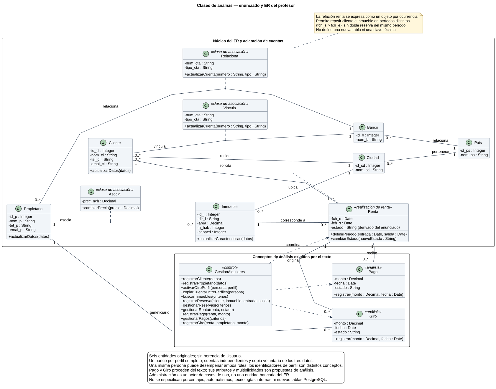

# Diagrama de clases — enunciado y modelo del profesor

[Fuente editable](clases_profesor.puml) · [Casos de uso relacionados](DIAGRAMA_CASOS_USO.md).

## Fuentes y alcance

Este diseño de análisis se contrastó con las siguientes fuentes, en este orden:

1. **Proyecto - Airbnb.pdf**, página 1: aplicación web en Java y PostgreSQL; propietarios ofrecen inmuebles por días; clientes registrados buscan y arriendan; la administración gestiona rentas, reservaciones, pagos y giros. Su imagen contiene las seis entidades y sus relaciones.
2. **Aclaraciones del usuario:** cliente y propietario son entidades separadas; una persona puede registrarse como cualquiera de ellos o ambos y activar posteriormente el otro perfil. Cada perfil tiene banco, número y tipo de cuenta modificables. Una opción explícita copia los tres datos a ambos perfiles. Ambas relaciones bancarias tienen sus propios atributos, aunque el PDF original solo los dibuje en cliente–banco.
3. **3 - Diagrama de clases.pdf**, páginas 6–12 y 15–20: compartimentos, tipos, visibilidad, asociaciones, multiplicidades, restricciones y dependencias. Las clases empiezan con mayúscula; los atributos y operaciones, con minúscula.
4. **4 - Casos de Uso.pdf**, páginas 14 y 19–24: el diseño estructural debe permitir realizar los comportamientos requeridos.

Es una entrega académica adicional, sin modificar la aplicación ni representar sus clases Java, sus 19 tablas o sus mecanismos técnicos. El enunciado completo exige más comportamiento que el que puede expresar por sí solo el ER. Por eso se distinguen el núcleo del ER y los conceptos mínimos de análisis necesarios para pagos, giros y gestión. Estas clases adicionales **no son entidades añadidas al ER ni una propuesta de nuevas tablas**.

## Núcleo del modelo

| Clase | Atributos del ER | Responsabilidad |
|---|---|---|
| Propietario | id_p, nom_p, tel_p, emai_p | Persona que ofrece inmuebles. |
| Cliente | id_cl, nom_cl, tel_cl, emai_cl | Persona que solicita una renta y reside en una ciudad. |
| Inmueble | id_i, dir_i, area, n_hab, capacd | Bien que puede ofrecerse por días. |
| Ciudad | id_cd, nom_cd | Ubicación del inmueble y residencia del cliente. |
| Pais | id_ps, nom_ps | País de ciudades y bancos. |
| Banco | id_b, nom_b | Entidad bancaria asociada al perfil. |

Se respeta `emai_p` y `emai_cl`, como aparecen en la imagen original. Las formas singulares son nombres de clases UML; no cambian la denominación de las entidades o tablas del profesor. Los identificadores son Integer, área y precio son Decimal, fechas son Date; teléfonos y números de cuenta son String para conservar formato y ceros iniciales. Los atributos son privados (`-`) y las operaciones públicas (`+`).

## Relaciones y multiplicidades

| Relación | Traducción UML y atributos |
|---|---|
| Asocia | Un propietario por inmueble; un propietario puede asociar varios inmuebles. Clase de asociación Asocia, con prec_nch. |
| Relaciona propietario–banco | Un banco por perfil de propietario completo; varios propietarios pueden usar el mismo banco. Clase de asociación Relaciona con num_cta y tipo_cta. |
| Vincula cliente–banco | Un banco por perfil de cliente completo; varios clientes pueden usar el mismo banco. Clase de asociación Vincula con sus propios num_cta y tipo_cta. |
| Renta | Cada ocurrencia pertenece a un cliente y un inmueble. Ambos pueden tener varias ocurrencias. Renta conserva fch_e y fch_s. |
| Ubica | Cada inmueble tiene una ciudad; una ciudad puede tener varios inmuebles. |
| Reside | Cada cliente reside en una ciudad; una ciudad puede tener varios clientes. |
| Pertenece | Cada ciudad pertenece a un país; un país puede contener varias ciudades. |
| Relaciona banco–país | Cada banco pertenece a un país; un país puede tener varios bancos. |

En los extremos múltiples se propone `0..*`: el dibujo no especifica participación mínima. Los extremos marcados `1` se interpretan como exactamente uno en un registro completo. Un perfil durante la captura puede estar incompleto; el diagrama muestra la información final válida.

Asocia, Vincula y Relaciona son clases de asociación, conectadas con línea discontinua al vínculo. Número y tipo de cuenta pertenecen al vínculo, no al Banco. Cambiar el banco reemplaza la asociación del perfil y se guarda junto con los otros dos datos.

Renta se representa como una **clase que materializa cada ocurrencia de la relación**, con dos asociaciones ordinarias. Una clase de asociación UML estricta restringiría los vínculos repetidos entre los mismos extremos. Esta representación permite rentar de nuevo el mismo inmueble en otro período sin inventar id_ocupacion, num_intento u otras claves del sistema implementado. La reservación y su evolución a renta se describen mediante el estado de esa misma ocurrencia; no se crea una entidad Reserva adicional al ER.

## Conceptos derivados del enunciado

| Concepto | Justificación y decisiones de análisis |
|---|---|
| Pago | El texto exige gestionar pagos de clientes. Se propone monto, fecha y estado. Cada pago corresponde a una renta, cuyo cliente determina el pagador. Se admite cero o varios registros para representar intentos o pagos parciales; el enunciado no fija esa cardinalidad. |
| Giro | El texto exige gestionar giros a propietarios. Se propone monto, fecha y estado. Cada giro corresponde a una renta y un propietario beneficiario, asociado al inmueble. Se admite cero o varios registros; no se afirma que el enunciado exija pagos fraccionados. |
| GestionAlquileres | Clase de control de análisis que coordina los objetivos funcionales: registro, activación de perfiles, copia de cuentas, búsqueda, reservación y gestión administrativa. Sus dependencias expresan colaboración, sin imponer arquitectura Java o persistencia. |
| Renta.estado | Propuesta para distinguir una reservación y su evolución administrativa. El texto exige gestionar ambas, pero no define estados ni transiciones exactas. |

Las operaciones mostradas son responsabilidades propuestas, no firmas extraídas del código. Los parámetros abreviados de GestionAlquileres representan información del dominio, sin decidir DTO, framework o implementación. Administración figura como **actor externo** en los casos de uso: su existencia funcional no obliga a añadir una entidad Administrador al ER.

## Reglas y límites del análisis

- Propietario y Cliente permanecen independientes, sin generalización Usuario o Persona. Su pertenencia a la misma persona se reconoce funcionalmente al activar ambos perfiles; se deja fuera de esta entrega el mecanismo técnico de identificación y autenticación.
- No se crea dos veces un perfil ya existente. Copiar una cuenta exige ambos perfiles y elección expresa; se copian banco, número y tipo como una sola operación, conservando los dos valores anteriores si falla. Editarlos después en un perfil no modifica el otro.
- La salida debe ser posterior a la entrada. Se propone comprobar disponibilidad para evitar arrendar simultáneamente el mismo bien. Estas validaciones se derivan del sentido de rentar por días, no de restricciones escritas en el ER.
- Se propone validar precio y montos positivos, capacidad suficiente y relaciones existentes. No se atribuyen al profesor tipos de cuenta permitidos, formato exacto del número, plazo de pago, porcentajes o reglas de redondeo que el enunciado no determina.
- Antes de registrar un giro se comprueban pago registrado, monto disponible, beneficiario y su cuenta. No se presupone transferencia bancaria real, conexión con un banco ni proveedor de pagos.
- No se fuerzan herencia, composición ni agregación: el modelo no establece reglas de sustitución o destrucción conjunta que las justifiquen.

## Trazabilidad con los casos de uso

| Requisito | Elementos que lo realizan | Casos |
|---|---|---|
| Registro y doble perfil aclarados por el usuario | Cliente, Propietario, GestionAlquileres | CU01–CU04 |
| Cuenta independiente, editable y copia voluntaria | Vincula, Relaciona, Banco, GestionAlquileres | CU05–CU06 |
| Ofrecer inmuebles y precio por noche | Propietario, Inmueble, Asocia, Ciudad | CU07 |
| Buscar inmuebles para arriendo | Inmueble, Asocia, Ciudad, Pais | CU08 |
| Reservaciones y renta por días | Cliente, Renta, Inmueble, GestionAlquileres | CU09–CU10, CU13, CU15–CU16 |
| Pagos de clientes | Pago, Renta, GestionAlquileres | CU11–CU12 |
| Giros a propietarios | Giro, Pago, Renta, Propietario, Relaciona | CU14, CU17 |

Java, PostgreSQL e interfaz web son requisitos tecnológicos del enunciado, no clases del dominio. Este documento y su compañero cubren **clases y casos de uso**; el enunciado también exige interacción, actividades, informe, código y demostración, que no se sustituyen con estos dos archivos. Como contexto de entrega, la página 1 establece grupos de dos personas y fecha límite del 20 de noviembre de 2026 a las 18:00, con una instalación funcional e información precargada sugeridas para la demostración. Estas condiciones no agregan clases ni casos de uso.
